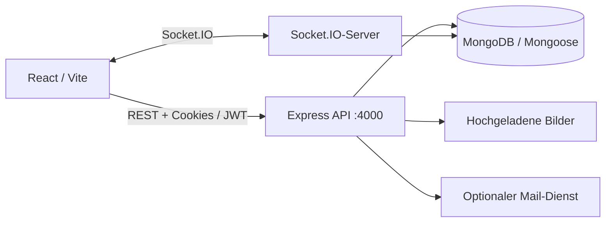

# Instagram-inspiriertes soziales Netzwerk — Full-Stack-Anwendung

**Eine Social-Network-Anwendung mit Anmeldung, Beiträgen, Followern, Kommentaren, Nachrichten und Echtzeit-Updates.**

**Sprache:** [English](README.md) · Deutsch · [Bisherige ausführliche Dokumentation](README.legacy.md)

**Technologien:** React 18 · Vite · Node.js · Express · MongoDB / Mongoose · JWT · Socket.IO · Multer / Sharp

> **Status:** Full-Stack-Portfolio-Projekt. Frontend- und Backend-Code sind vorhanden; ein produktiv bereitgestellter Dienst wird durch das Repository nicht unabhängig nachgewiesen. Die Anwendung ist von Instagram inspiriert und steht in keiner Verbindung zu Instagram oder Meta.

## Einblicke in die Anwendung

Die folgenden Screenshots sind bereits im Repository vorhanden. Relative Pfade bleiben auch nach einer Umbenennung des Projekts gültig.


Alle Bilder: [`frontend/public/docs/`](frontend/public/docs/). Vor einer weiteren Veröffentlichung bitte prüfen, ob nur freigegebene Testkonten und Inhalte zu sehen sind.

## Funktionen

- Registrierung und Anmeldung mit JWT-Access-Tokens und Refresh-Token-Rotation.
- Nutzerprofile, Folgen/Entfolgen und Benutzersuche.
- Beiträge erstellen, ansehen, liken, bearbeiten und löschen; Kommentare und Kommentar-Likes.
- Upload und Bearbeitung von Beitrags- und Profilbildern mit Multer und Sharp.
- Private Nachrichten, Benachrichtigungen und Online-Ereignisse über Socket.IO.
- Passwortzurücksetzung per E-Mail bei konfiguriertem E-Mail-Anbieter.

## Architektur



| Bereich | Code |
| --- | --- |
| Frontend-Seiten / Views | `frontend/src/pages/` |
| API-Client und Token-Refresh | `frontend/src/services/api.js` |
| Express-App | `backend/src/app.js` |
| Socket.IO-Einbindung | `backend/src/socket.js` |
| Authentifizierung | `backend/src/config/jwt.js`, Auth-Controller |
| Mongoose-Modelle / API-Routen | `backend/src/models/`, `backend/src/routes/` |

## Lokal starten

**Voraussetzungen:** Node.js, npm, eine erreichbare MongoDB-Instanz und lokale Umgebungsvariablen. Ein zentraler Ein-Kommando-Installer ist nicht enthalten.

**1. Backend** (Terminal A):

```bash
cd backend
npm install
npm run dev
```

Vorher eigene Secrets und Konfiguration in `backend/.env` eintragen, darunter mindestens `MONGODB_URI` und `JWT_SECRET`. `CORS_ORIGIN=http://localhost:5173`, `PORT=4000` und `REFRESH_JWT_SECRET` passend setzen. Keine echten Zugangsdaten committen. Für E-Mails ist zusätzlich eine Provider-Konfiguration nötig.

Backend-Healthcheck: [http://localhost:4000/api/health](http://localhost:4000/api/health).

**2. Frontend** (Terminal B):

```bash
cd frontend
npm install
npm run dev
```

Vite ist üblicherweise unter [http://localhost:5173](http://localhost:5173) erreichbar. Der API-Client verwendet `VITE_API_URL` oder standardmäßig `http://localhost:4000/api`. Die CORS-Einstellung des Backends muss dazu passen.

Die Befehle stammen aus dem bestehenden Projekt. Start, Datenbankanbindung und E-Mail-Versand wurden für diese README-Änderung **nicht ausgeführt oder unabhängig bestätigt**.

## Technische Schwerpunkte

- Die REST-Routen sind nach Domänen getrennt: Authentifizierung, Nutzer, Posts, Follows, Kommentare, Nachrichten, Benachrichtigungen.
- Separater Refresh-Token-Ablauf mit automatischem Axios-Retry/Interceptor im Frontend.
- Socket.IO ergänzt REST um Echtzeitereignisse.
- Bilder werden serverseitig verarbeitet; die API verwendet Helmet, CORS und Middleware.

## Sicherheit und Grenzen

- Kein offizieller Instagram-Client; für die Codebewertung werden keine Fremdkonten benötigt.
- Vorhandene Sicherheitsmiddleware ersetzt weder einen Penetrationstest noch eine Produktionsfreigabe.
- Eine MongoDB-Instanz und gültige Konfiguration sind Voraussetzung; ein sofort nutzbarer öffentlicher Demo-Server ist nicht enthalten.
- Screenshots, hochgeladene Bilder und Testkonten vor externer Weitergabe auf Datenschutz und Nutzungsrechte prüfen.
- Im geprüften Repository wurde kein GitHub-Actions-Workflow im Root festgestellt.

## Einminütige Demo

Testkonto registrieren → Testbeitrag erstellen → liken/kommentieren → zweites Testkonto folgen → Benachrichtigung oder Nachricht zeigen → REST/Socket.IO und Token-Refresh erklären.

## Technische Details

Die ausführlichen API-, Routen- und Konfigurationsnotizen bleiben in [`README.legacy.md`](README.legacy.md) erhalten.

*Portfolio-Schwerpunkte: Full-Stack JavaScript, Authentifizierung, MongoDB-Datenmodelle, Echtzeitkommunikation und Bildverarbeitung.*