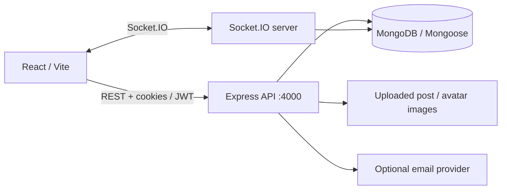

# Instagram-Inspired Social Network — Full-Stack Application

**A social-network application with authentication, posts, follows, comments, messaging and real-time updates.**

**Language:** English · [Deutsch](README.de.md) · [Detailed original documentation](README.legacy.md)

**Stack:** React 18 · Vite · Node.js · Express · MongoDB / Mongoose · JWT · Socket.IO · Multer / Sharp

> **Status:** Full-stack portfolio project. The repository contains frontend and backend code; it does not independently demonstrate a deployed production service. This is an independently developed Instagram-inspired application, not affiliated with Instagram or Meta.

## Application previews

These are pre-existing repository screenshots. The paths are relative so GitHub renders them even after repository renaming.


See all screenshots in [`frontend/public/docs/`](frontend/public/docs/). Before wider sharing, confirm they contain only demo accounts and content you are permitted to publish.

## Main capabilities

- Registration and login with JWT access tokens and refresh-token rotation.
- User profiles, follow/unfollow functionality and user search.
- Create, view, like, edit and delete posts; comments and comment likes.
- Upload post and avatar images using Multer and Sharp.
- Private messaging, notifications and online events using Socket.IO.
- Password reset by email when an email provider is configured.

## Architecture



| Area | Source |
| --- | --- |
| Frontend routes / views | `frontend/src/pages/` |
| API client and token refresh | `frontend/src/services/api.js` |
| Express app | `backend/src/app.js` |
| Socket.IO setup | `backend/src/socket.js` |
| Authentication | `backend/src/config/jwt.js`, auth controllers |
| Database models / API routes | `backend/src/models/`, `backend/src/routes/` |

## Run locally

**Prerequisites:** Node.js, npm, a reachable MongoDB instance, and local environment variables. This repository has no root one-command installer.

**1. Backend** (terminal A):

```bash
cd backend
npm install
npm run dev
```

Before starting, supply your own secrets and configuration via `backend/.env`, including at least `MONGODB_URI` and `JWT_SECRET`. Configure `CORS_ORIGIN=http://localhost:5173`, `PORT=4000` and `REFRESH_JWT_SECRET` as appropriate. Never commit your real `.env` file. Email features require their own external provider configuration.

Backend health endpoint: [http://localhost:4000/api/health](http://localhost:4000/api/health).

**2. Frontend** (terminal B):

```bash
cd frontend
npm install
npm run dev
```

Vite normally serves the frontend at [http://localhost:5173](http://localhost:5173). The API client uses `VITE_API_URL` or defaults to `http://localhost:4000/api`; match the backend CORS origin.

These are the existing project scripts. Startup, MongoDB connectivity and email delivery were **not executed or verified** as part of this documentation update.

## Engineering highlights

- API endpoints are grouped by domain: authentication, users, posts, follows, comments, messages and notifications.
- Refresh tokens are handled through a separate refresh flow; the frontend includes an Axios retry/interceptor mechanism.
- Socket.IO delivers real-time events alongside REST requests.
- Image uploads use server-side processing; Helmet, CORS and middleware are present in the API.

## Boundaries and security

- This is not an official Instagram client and no third-party trademarks or accounts are needed to review the code.
- Security middleware does **not** replace a comprehensive penetration test or production readiness review.
- A MongoDB server and valid environment variables are required; a turnkey public demo is not included.
- Screenshots, uploaded media and stored users must be checked for privacy and distribution rights before public reuse.
- No root GitHub Actions CI workflow was identified during this review.

## Suggested 1-minute demo

Register a synthetic account → create a test post → like/comment → follow a second test user → demonstrate notifications or a test message → explain REST/Socket.IO and token refresh.

## More detail

Technical API inventory, routes and configuration notes are preserved in [`README.legacy.md`](README.legacy.md).

*Portfolio focus: Full-Stack JavaScript, authentication, MongoDB data modeling, real-time communication and media handling.*